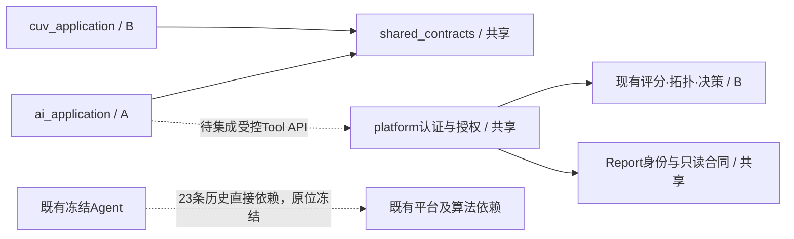
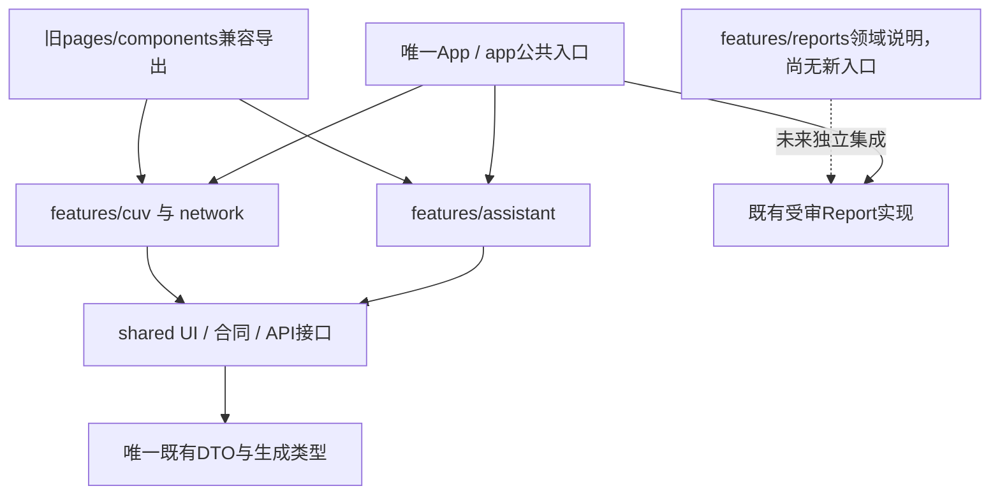

# 实际依赖与边界检查

## 审计基线

M0从Git对象 `602b56815f8c3d450197134668ad645dbc11bac7` 读取328个跟踪文件，提取691条Python/TypeScript直接依赖边。没有根据建议目录假定现有模块。Windows与179新隔离仓库328文件SHA一致；映射到旧179产品文件的内容没有差异，旧前端dirty状态保留。main与ui分支共同祖先为 `9a8a45dbe940a82456abac4ac3b1fb77c7707046`；本轮祖先为当前main，不包含UI候选提交。

- [原始逐文件职责/依赖/责任矩阵](M0_FILE_MATRIX.json)
- [当前逐文件矩阵](CURRENT_FILE_MATRIX.json)
- [固定原依赖与历史例外](dependency_baseline.json)
- [当前完整依赖边、转发关系和环检查](CURRENT_DEPENDENCIES.json)
- [Agent20、算法22、Report5完整冻结SHA](FROZEN_FILES.json)

矩阵包含实际路径、职责、直接依赖、目标路径、A/B/shared负责人、冻结/安全合同标志、可移动性、兼容方式及需要的测试。当前矩阵是结构审计产物，不能代替最终源码SHA封套。

## Python边界



实线表示当前包依赖；点线分别表示尚未接入的端口或保留的旧耦合。新AI不能直接导入platform、adapters、pipe_health、simulation、decision、冻结Agent或CUV实现。CUV不能导入AI/Agent；共享合同不能反向依赖领域或平台。新运行时代码不能通过tests目录绕过限制。

冻结Agent的旧调用没有被重构消除。例如tools/domain→adapters.scoring/platform.services，workflow→decision/simulation，graph/context→platform。23条精确source/target例外有两端SHA约束，不按目录全部放行，不可扩充以掩盖新增跨域依赖。

## React边界



实际组件仍由旧App通过兼容路径加载，避免改动待复审接线。A和B可以独立改变迁移后的内部实现；新增全局页面、跨域字段和Provider变更仍需共享集成PR。

shared只提供稳定UI、合同和明确的显示工具，不导出DemoProvider/PlatformProvider实例供领域绕过平台。8条shared→legacy桥接限纯导出，除生成类型由OpenAPI检查负责外，其余目标SHA固定。检查器解析转发落点，不能用旧components barrel跨进另一私有领域。

## 自动检查与范围

```bash
python -B scripts/check_module_boundaries.py
python -B -m unittest discover -s scripts -p test_module_boundaries.py -v
python -B -m unittest discover -s scripts -p test_offline_git_bundle.py -v
cd web
npm run contracts:check
npm run contracts:test
npm run typecheck
npm test -- --maxWorkers=2 --minWorkers=1
npm run build
```

Python使用AST解析绝对/相对导入、仓库namespace与多导入根，以及import_module显式package位置/关键字参数。__import__非零或不确定level明确拒绝，默认或level=0仍可用。AI/shared采用全部仓库本地目标的允许范围；CUV及燃气业务追踪本地helper到AI/Agent的间接依赖，未知动态目标拒绝。TypeScript使用本仓库编译器解析import/export/import()/require/type-import及paths，统一扫描.ts/.tsx/.mts/.cts/.js/.jsx/.mjs/.cjs；App等集成入口未解析的本地依赖也拒绝。原67项断言保留，FIX2追加27项fromlist和父包初始化反例/合法对照，当前共94项；静态__import__的fromlist及builtins显式模块/函数别名纳入解析。仓库父包__init__和namespace祖先初始化进入依赖图，同源包已进入的祖先不重复计为初始化依赖；构建图检查新增循环。

这属于静态代码边界和合同检查，不证明任意反射/动态执行的运行时安全。实际权限由平台负责；CI不能批准真实数据外发、解除冻结、合并或部署。

所有权与依赖领域分别检查：矩阵当前责任以CODEOWNERS为单一来源，`target_owner`描述迁移目标；依赖分类不因旧兼容代码的共享所有权而放宽。整表回归核对328项M0与当前所有路径的当前/目标责任、末匹配规则及大小写。

## 2026-11-05 导入门禁最小修复

当前依赖图为411文件、805边、0循环。增强解析补识别了原来已有的7条跨导入根依赖：scripts/start_synthetic_local.py的2条，以及web/tests/integration/m1b03/server.py的5条；不是业务新增依赖。M0的328文件/691边仍保留旧解析器的历史记录，dependency_baseline.json、23条历史例外及冻结清单未重建。修复仅调整检查器和追加测试，产品源码不变；独立复审的BLOCK状态等待新一轮验收，不因开发测试通过自动解除。


## 2026-11-05 FIX2：静态fromlist与父包初始化

本次只修复MODULAR-FIX-01/02。__import__的第4位置参数或fromlist关键字支持静态list/tuple字符串及点分子成员；本地未知名单和通配符拒绝，第三方不纳入本地所有权图。builtins模块、模块别名和from builtins导入的函数别名使用同一level/fromlist门禁；不声称解析任意赋值别名、getattr或反射。

父包依赖按相同解析根的真实__init__.py定位，覆盖普通import/from/import_module/__import__及无初始化文件的namespace子目录。当前411文件、1171依赖边、0循环；增加366条package_init边是原有Python初始化语义的补识别，产品源码未变。

23条历史例外及M0文件完全不改。对原冻结导入派生的package_init边，必须同时满足原source→via_target精确例外的两端SHA、初始化文件的原baseline.files SHA；任一不匹配或基线缺失均拒绝。此规则不批准新来源、新目标或更改后的初始化文件。新增测试逐项覆盖这些拒绝条件。

本次开发验证不解除独立复审BLOCK；受测完整SHA、94项前后对照、45组原审查输入重跑和业务回归在FIX2交付证据。原段落的805边/67项是上一轮历史记录。


## 2026-11-05 FIX3：缺失末级与源文件祖先初始化

静态fromlist的点分成员按前缀逐段记录。末级不存在时，中间实际存在的模块、包及namespace祖先仍进入依赖图；不把缺失末级成员视为无执行依赖。合法纯常量中间包继续允许。本轮未扩展任意反射，也未改变属性遮蔽同名子包时的保守静态限制。

源文件自身祖先的真实初始化文件另外记录在initialization_edges（kind=source_init）中，即使源文件没有显式import也记录。依据仓库支持的多个导入根保守覆盖包入口，包括燃气通过engineering根导入时的experiments祖先。普通依赖图的1171条边保持原含义；新增98条入口初始化边。权限可达检查合并两类边，循环检测仍只使用普通导入边，避免把合法包重导出自身模块误认为新增循环。普通显式循环仍拒绝。

CUV/Gas的初始化可达闭包不得进入AI/Agent；AI/shared允许隐式进入自身祖先，但祖先的实际导入仍须满足来源领域允许范围。未知动态初始化依赖拒绝。冻结Agent既有23条例外继续按原source/target SHA和派生父包基线SHA检查，本轮不增删例外、不重建baseline或M0。

当前文件矩阵另列initialization_dependencies，避免把这类入口关系混成普通循环。此变更只影响开发门禁，不修改Python业务运行、Agent、算法、Report或前端。本轮开发结果不能解除独立复审BLOCK，受测提交仍须另行验收。


## 2026-11-05 FIX4: relative package re-export container

Inside the current `__init__.py`, `from . import leaf` (including aliases and multiple explicit members) resolves the package container to the file already being initialized. When level is exactly 1, the module part is absent, no member is `*`, and that container uniquely resolves to the current initializer, the checker omits only the redundant container `from` edge. Every resolved `from_submodule` edge is retained, including child packages; nested re-exports are checked normally.

The condition does not apply to ordinary modules, higher relative levels, ambiguous package roots, wildcard imports, explicit absolute self imports, or child-to-parent back imports. Actual child imports, unknown dynamic dependencies, cross-domain reachability, explicit cycles and all 23 historical SHA-pinned permissions remain checked. No blanket self-edge or SCC exemption is introduced. Existing declared reflection/attribute-shadowing limits remain unchanged; this change does not implement `__all__` analysis.

This fixes D8-REEXPORT-01's false rejection only. It does not change Agent, business algorithms, Report, frontend behavior, runtime authorization or deployment. Development validation is recorded in VALIDATION.md; independent acceptance is still required before merge.
